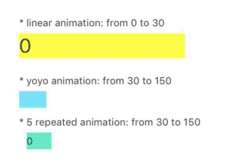

# ValueAnimator

[](http://cocoapods.org/pods/ValueAnimator)
[](http://cocoapods.org/pods/ValueAnimator)
[](http://cocoapods.org/pods/ValueAnimator)


Lightweight value interpolation with easing functions for Apple platforms.

ValueAnimator transitions a value from `from` to `to` over time and reports each frame through a callback.
You can animate a single property or multiple properties simultaneously.

## Demo



## Usage

### Simple animation

```swift
let animator = ValueAnimator.animate(
    "rotation",
    from: 0,
    to: 360,
    duration: 1.0,
    easing: EaseCircular.easeIn(),
    onChanged: { property, value in
        print("property \(property): \(value.value)")
    }
)

animator.resume()
```

### Multiple properties + yoyo

```swift
let animator = ValueAnimator.animate(
    props: ["h", "w"],
    from: [20, 30],
    to: [5, 150],
    duration: 1.4,
    easing: EaseSine.easeInOut(),
    onChanged: { property, value in
        if property == "h" {
            let width = self.rect1.bounds.width
            self.rect1.frame = CGRect(x: 24, y: 140, width: width, height: value.cg)
        } else {
            let height = self.rect1.bounds.height
            self.rect1.frame = CGRect(x: 24, y: 140, width: value.cg, height: height)
        }
    },
    option: ValueAnimator.OptionBuilder()
        .setYoyo(true)
        .setRepeatCount(2)
        .build())

animator.resume()
```

### Completion callback

```swift
let animator = ValueAnimator.animate(
    props: ["alpha"],
    from: [0.0],
    to: [1.0],
    duration: 0.5,
    onEnd: {
        print("animation completed")
    }
)

animator.resume()
```

### Callback thread

By default, `changeCallback` and `endCallback` are dispatched on the main thread.
If you need callbacks on the animation engine thread, set `callbackOnMainThread = false`.

```swift
let animator = ValueAnimator.animate(
    "opacity",
    from: 0,
    to: 1,
    duration: 1.0,
    easing: EaseCircular.easeIn(),
    onChanged: { _, _ in
        // called on ValueAnimator engine thread
    },
)
animator.callbackOnMainThread = false
animator.resume()
```

### Static controls

```swift
ValueAnimator.finishAll()
ValueAnimator.disposeAll()

Task {
    let isAnimating = await ValueAnimator.hasAnimation("opacity")
    print(isAnimating)
}
```

## Example

To run the example project, clone the repo, and run **open ValueAnimator.xcworkspace**. 
You can see ValueAnimatorExample project.

## Requirements

- iOS 13+
- tvOS 13+
- macOS 10.15+
- watchOS 6+

## Installation


### [Swift Package Manager](https://swift.org/package-manager/)

- Open Xcode
- Go to File > Add Package Dependencies...
- Paste this repository URL:

```text
https://github.com/brownsoo/ValueAnimator
```

- Select the `ValueAnimator` package and add it to your target.


### [CocoaPods](http://cocoapods.org)

> [!WARNING]
> CocoaPods support is now legacy and no longer actively updated.
> Please use Swift Package Manager for the latest updates.

Previously, you could add:

```ruby
pod 'ValueAnimator'
```

## Author

brownsoo, [@medium](https://medium.com/@brownsoo)

## License

ValueAnimator is available under the MIT license. See the LICENSE file for more info.
